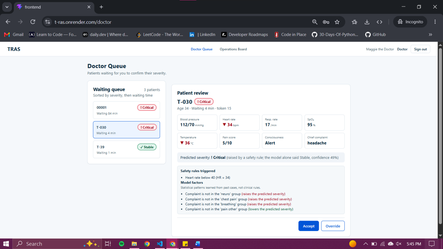

# TRAS: Machine Learning-Assisted Emergency Department Triage and Resource Allocation System

TRAS is an advisory web application for an emergency department (ED). It predicts how severe a patient's condition is from their vitals and chief complaint, explains the prediction, and recommends a room. Clinicians stay in control: a doctor confirms or overrides every severity, and the nurse in charge confirms, modifies or rejects every room.

Software Engineering project 1, SWE3090A, Fall 2026, United States International University-Africa (USIU-Africa).
Author: Joy Wanjiru Ndung'u. Supervisor: Dr. Fredrick Ogore.

**Live demo: https://t-ras.onrender.com**

On the login page, use the **Try the demo** panel to sign in as a triage nurse, a doctor or a nurse in charge. The server runs on a free hosting tier and sleeps when idle, so the first sign-in can take up to a minute.

> **Demonstration only.** TRAS was trained on a public dataset and tested with invented patients. It is not a medical device and must not be used to make real clinical decisions.



## How it works

TRAS follows a three-role ED workflow:

1. **Triage nurse** enters the patient's vitals and chief complaint.
2. **The model predicts a severity** (Critical, Urgent or Stable) and shows the main reasons. A rule-based safety floor raises the severity when vitals are dangerous. It never lowers it.
3. **Doctor** reviews the queue, then accepts the prediction or overrides it with a reason. The doctor chooses which patient to see.
4. **The system recommends a room** by severity. Critical patients are fast-tracked: their room is confirmed automatically.
5. **Nurse in charge** confirms, modifies or rejects the recommended room, and records the outcome (admitted, discharged or transferred), which frees the room.

The queue is ordered by severity, then waiting time. Stable patients share one Stable Waiting Area (10 places) so that rooms stay free for sicker patients.

## Features

- Role-based sign-in (triage nurse, doctor, nurse in charge) with Supabase Authentication
- Triage entry form with an oxygen guard: oxygen must be entered or marked "could not be measured"
- XGBoost severity prediction, with safety rules and model factors shown separately
- Safety floor for dangerous vitals, such as oxygen below 90% or heart rate below 40
- Doctor queue with accept and override (a reason is required to override)
- Rule-based room recommendation, fast-track for Critical patients, and room confirm, modify and reject
- Operations board with waiting patients, room status and the waiting area
- Outcome recording that releases the room

## Model results

Held-out test set of 254 patients (stratified 80/20 split):

| Version | Accuracy | Critical recall |
| --- | --- | --- |
| XGBoost model | 74.0% | 63.3% |
| Model + safety floor | 75.2% | 69.4% |

Confusion matrix of the model alone (rows are the true class, in the order Critical, Urgent, Stable):

```
[[31, 12,  6],
 [16, 60, 22],
 [ 8,  2, 97]]
```

The model was trained on the [KTAS emergency triage dataset](https://www.kaggle.com/datasets/ilkeryildiz/emergency-service-triage-application) with 25 features: 13 base columns plus 12 complaint groups made from keyword rules.

## Tech stack

| Part | Technology |
| --- | --- |
| Frontend | React, Vite |
| Backend | Python, Flask (REST API), gunicorn |
| Database and auth | Supabase (PostgreSQL, Supabase Auth) |
| Machine learning | Python, pandas, scikit-learn, XGBoost |
| Hosting | Render (backend and static frontend) |
| Design and diagrams | Figma, draw.io |

## Project structure

```
frontend/   React app (login, triage entry, doctor queue, board, rooms)
backend/    Flask API: model inference, explanations, room allocation, tests
ml/         Data preparation, model training, complaint rules, safety rules
db/         Supabase (PostgreSQL) schema and migrations
docs/       Proposal, diagrams, UI designs and screenshots
```

## Run it locally

You need Python 3.10 or newer, Node.js 18 or newer, and a free [Supabase](https://supabase.com) project.

### 1. Database

1. Create a Supabase project.
2. In the SQL editor, run the schema and room setup from `db/`. This creates the rooms and the Stable Waiting Area.
3. Create three users in Supabase Authentication and add each to the `app_user` table with one of the roles `triage_nurse`, `doctor` or `nurse_in_charge`.

### 2. Backend

```bash
cd backend
python -m venv .venv
.venv\Scripts\activate          # Windows
# source .venv/bin/activate     # macOS / Linux
pip install -r requirements.txt
```

Create a `.env` file in the project root (never commit it):

```
SUPABASE_URL=https://your-project.supabase.co
SUPABASE_KEY=your-service-key
```

Start the API:

```bash
python app.py
```

It runs on http://127.0.0.1:5000. Check it at http://127.0.0.1:5000/health.

### 3. Frontend

```bash
cd frontend
npm install
```

Create `frontend/.env` (never commit it):

```
VITE_API_URL=http://127.0.0.1:5000
VITE_SUPABASE_URL=https://your-project.supabase.co
VITE_SUPABASE_ANON_KEY=your-anon-key
```

```bash
npm run dev
```

Open http://localhost:5173 and sign in with one of your three users.

## Deployment

| Part | Service | Notes |
| --- | --- | --- |
| Backend | Render web service | Root `backend`, start command `gunicorn app:app`, health check `/health`. Set `SUPABASE_URL`, `SUPABASE_KEY` and `FRONTEND_URL`. |
| Frontend | Render static site | Root `frontend`, build `npm install && npm run build`, publish `dist`, with a rewrite of `/*` to `/index.html`. Set `VITE_API_URL`, `VITE_SUPABASE_URL` and `VITE_SUPABASE_ANON_KEY`. |

Only the Supabase anon key is used in the frontend. The service key stays on the backend.

## Tests

With the backend running and test accounts added to `.env`:

```bash
cd backend
python e2e_test.py            # end-to-end workflow, role security, waiting area
cd ../ml
python test_safety_rules.py   # safety floor checks (no database needed)
```

`e2e_test.py` resets the rooms and creates test patients whose codes start with `E2E-`. Run it against a test database, not live data.

## Design decisions

- **Advisory, not automatic.** Every prediction and every room can be overridden by a person.
- **Doctor in the loop.** After talking to a nurse working in an ED, the workflow changed so that the doctor confirms severity and chooses patients. The system recommends rooms only.
- **Safety floor.** Rules for dangerous vitals only ever raise a severity. They are a safety net, not a second model.
- **Shared waiting area.** Stable patients share one area, and the last place is claimed so that two users cannot take it at once.

## Limitations

- Trained on a public dataset, not on local hospital data, and not tested with real patients.
- Critical recall is 69.4%, so some Critical patients are still missed. The doctor must always review.
- The safety thresholds are standard adult values and have not been reviewed by a clinician. They do not apply to children.
- The dashboard refreshes by polling every few seconds, not in real time.
- No manual fallback if the model service is down, and no database row-level security policies yet.
- Free hosting sleeps when idle, so the first request can be slow.

## Future work

- Validate and tune the model with anonymised local hospital data
- Review of the thresholds by an emergency physician, plus paediatric thresholds
- User acceptance testing with nurses and doctors
- Real-time updates with Supabase Realtime and row-level security policies
- Alerts for Critical patients who wait too long, and waiting-time reports

## Design

Figma designs: [https://www.figma.com/design/xVi8ed5umQL1CQdqZqWWsG/TRAS?node-id=0-1&p=f&t=vgv8xLCHda88f85d-0]

## Data
Used a kaggle dataset [https://www.kaggle.com/datasets/ilkeryildiz/emergency-service-triage-application] 
Only anonymised, public or synthetic data is used. No datasets, keys or credentials of real patients are stored in this repository.

## Acknowledgements

Thanks to Dr. Fredrick Ogore for supervision, and to the emergency department nurse whose description of the real workflow shaped the design.

## License

The code in this repository is released under the [MIT License](LICENSE). The KTAS dataset is not covered by this license and remains under its original terms.
